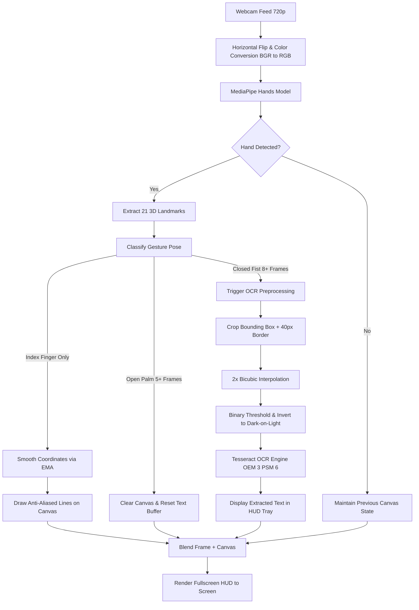

<div align="center">

# ✨ AI Air-Writing & Gesture Recognition System ✨

**Write in thin air using computer vision, track finger movements in real time, and convert mid-air handwriting into digital text.**

[](https://www.python.org/)
[](https://opencv.org/)
[](https://developers.google.com/mediapipe)
[](https://github.com/tesseract-ocr/tesseract)
[](LICENSE)
[](https://microsoft.com/windows)

[Key Features](#-key-features) •
[Architecture](#-system-architecture) •
[Gesture Controls](#-gesture-controls) •
[Quickstart](#-installation--quickstart) •
[Configuration](#%EF%B8%8F-configuration) •
[Troubleshooting](#-troubleshooting--faq)

</div>

---

## 📌 Overview

The **AI Air-Writing System** transforms a standard webcam into a touchless digital drawing pad and OCR engine. Using state-of-the-art hand landmark detection via **Google MediaPipe** and digital image processing with **OpenCV**, it tracks the tip of your index finger in 3D space, overlays smooth anti-aliased strokes onto the live video feed, and utilizes **Tesseract OCR** to transcribe handwritten letters, words, and numbers into digitized text in real time.

No specialized hardware, depth cameras, or wearable sensors are needed—just a laptop or desktop camera!

---

## 🚀 Key Features

- 🖐️ **Real-Time 21-Landmark Hand Tracking**: Powered by MediaPipe Hands with low latency and high accuracy.
- ✍️ **Jitter-Free Air Writing**: Implements Exponential Moving Average (EMA) coordinate smoothing (`\(\alpha = 0.28\)`) to eliminate natural hand trembling and produce clean, continuous curves.
- 🤖 **On-Demand OCR Extraction**: Uses an intelligent preprocessing pipeline (bounding-box crop, edge padding, cubic scaling, threshold inversion) feeding into Tesseract OCR for text extraction.
- ✋ **Natural Gesture State Machine**:
  - **Index Point**: Write / Draw.
  - **Open Palm**: Reset & wipe the canvas.
  - **Closed Fist**: Convert handwritten strokes into text.
  - **Neutral Hover**: Reposition the hand without drawing.
- 🛡️ **Debounce & Cooldown Protection**: Multi-frame gesture verification and timing cooldowns prevent accidental erasures or duplicate triggers.
- 🖥️ **Interactive Heads-Up Display (HUD)**: Fullscreen mirrored camera feed with real-time gesture feedback badge and a live text transcription tray.
- ⌨️ **Dual Input Mode**: Full air-gesture support paired with keyboard fallback hotkeys (`C` to clear, `R` to recognize, `Esc` to quit).

---

## 🏗️ System Architecture

The pipeline processes each webcam frame through detection, gesture classification, trajectory rendering, and optical character recognition:



---

## 🎮 Gesture Controls

The system classifies hand poses based on relative landmark positions (`tip_id` vs `pip_id`).

| Gesture | Pose Preview | Detection Criteria | Action | Hotkey Equivalent |
| :--- | :---: | :--- | :--- | :---: |
| **Write** | ☝️ | Index finger extended; middle, ring, and pinky folded | Draws white anti-aliased strokes on screen | — |
| **Clear Canvas** | 🖐️ | All 4 fingers extended (held for \(\ge\) 5 frames) | Clears all drawings and resets recognized text | <kbd>C</kbd> |
| **Recognize Text** | ✊ | All fingers curled into a fist (held for \(\ge\) 8 frames) | Triggers OCR pipeline to extract text | <kbd>R</kbd> |
| **Hover / Move** | ✌️ / ✋ | Any neutral pose (e.g. 2 fingers, relaxed hand) | Moves cursor without leaving ink | — |
| **Exit** | — | — | Closes the application and releases camera | <kbd>Esc</kbd> |

---

## 🛠️ Tech Stack & Requirements

- **Programming Language**: Python 3.10 / 3.11
- **Computer Vision**: OpenCV (`opencv-contrib-python==4.11.0.86`)
- **Hand Tracking**: Google MediaPipe (`mediapipe==0.10.21`)
- **Scientific Computing**: NumPy (`numpy==1.26.4`)
- **OCR Engine**: Tesseract OCR engine + Python wrapper (`pytesseract==0.3.13`)
- **Supported Operating Systems**: Windows 10/11 (macOS / Linux compatible with minor path adjustment)

---

## 📦 Installation & Quickstart

### Step 1: Clone the Repository

```bash
git clone https://github.com/OmBawankule/AI-Air-Writing-System.git
cd AI-Air-Writing-System
```

### Step 2: Create a Virtual Environment (Recommended)

Using Python 3.11:

```powershell
# Windows PowerShell
py -3.11 -m venv .venv
.\.venv\Scripts\Activate.ps1
```

> **Note**: If script execution is restricted on Windows, run `Set-ExecutionPolicy -Scope Process -ExecutionPolicy Bypass` first.

### Step 3: Install Python Dependencies

```powershell
python -m pip install --upgrade pip
python -m pip install -r requirements.txt
```

### Step 4: Install Tesseract OCR

Tesseract is an external OCR binary that must be installed on your system:

1. Download the Windows installer from [UB-Mannheim Tesseract Wiki](https://github.com/UB-Mannheim/tesseract/wiki).
2. Run the installer and install to the default path:
   ```text
   C:\Program Files\Tesseract-OCR\tesseract.exe
   ```
3. *(Optional)* Add `C:\Program Files\Tesseract-OCR` to your system `PATH` environment variable.

### Step 5: Launch the Application

```powershell
python air_writing_ready.py
```

---

## ⚙️ Configuration

Key runtime parameters can be adjusted directly at the top of [`air_writing_ready.py`](air_writing_ready.py):

```python
# ---------------- CONFIGURATION ----------------
# Path to your Tesseract OCR executable binary
TESSERACT_PATH = r"C:\Program Files\Tesseract-OCR\tesseract.exe"

# Camera index (0 for default built-in camera, 1 or 2 for external webcams)
CAMERA_INDEX = 0

# Width of the drawing stroke in pixels
BRUSH_THICKNESS = 12

# Exponential smoothing factor between 0.0 (maximum lag) and 1.0 (raw input, jittery)
SMOOTHING = 0.28
# ------------------------------------------------
```

---

## 💡 Best Practices for Maximum OCR Accuracy

Air writing is inherently continuous and unconstrained. To achieve the best character recognition:

1. **Light & Contrast**: Ensure your hand and face are well-lit. Avoid bright backlights (windows/lamps behind you).
2. **Write in Capital Block Letters**: Tesseract performs best on distinct, separated characters (`HELLO`, `AI`, `123`) rather than cursive or connected script.
3. **Write Large & Centered**: Allocate generous space for each letter across the screen. Larger strokes preserve character anatomy after downsampling.
4. **Pause Between Strokes**: Switch to a neutral hand gesture when lifting your "pen" between disconnected letter parts (like crossing a `T` or dotting an `I`).
5. **Clear Old Strokes**: If letters overlap too densely, wipe the canvas using the **Open Palm** gesture before beginning a new word.

---

## 🔍 Troubleshooting & FAQ

| Problem | Root Cause | Solution |
| :--- | :--- | :--- |
| **`RuntimeError: Could not open webcam`** | Another app is using the camera, or wrong index | Close apps like Zoom, Teams, or Windows Camera. If using an external camera, set `CAMERA_INDEX = 1` in `air_writing_ready.py`. |
| **`TesseractNotFoundError`** | Tesseract binary not found at specified path | Verify installation at `C:\Program Files\Tesseract-OCR\tesseract.exe` or update `TESSERACT_PATH` in `air_writing_ready.py`. |
| **Hand landmarks flicker or jitter** | Poor lighting or hand too close/far | Ensure good lighting, stay 1.5 to 3 feet from the lens, and increase `min_detection_confidence` to `0.80`. |
| **Strokes feel sluggish / lagging** | Smoothing factor too low | Increase `SMOOTHING` from `0.28` to `0.45` for faster responsiveness. |
| **OCR returns "No writing detected"** | Canvas was empty or strokes too faint | Draw bolder letters with index finger before triggering the fist gesture. |

---

## 📁 Project Structure

```text
AI-Air-Writing-System/
├── .venv/                   # Virtual environment (ignored by git)
├── .gitignore               # Git ignore rules for Python, cache, and IDEs
├── air_writing_ready.py     # Main application (tracking, rendering, OCR)
├── requirements.txt         # Pinned Python package dependencies
├── LICENSE                  # MIT License
└── README.md                # Project documentation and guide
```

---

## 🗺️ Roadmap & Future Enhancements

- [ ] **Color Palette & Air Color Selection**: Select brush colors (Red, Blue, Green, Yellow) using gesture buttons in the top bar.
- [ ] **Dedicated Deep Learning OCR**: Integrate a lightweight handwriting CRNN/Transformer model (e.g. trained on IAM / EMNIST) for superior cursive recognition.
- [ ] **Eraser Gesture**: Two-finger peace sign (`V`) gesture to erase specific strokes without wiping the entire canvas.
- [ ] **Canvas Export**: Press <kbd>S</kbd> to save the drawn canvas to a timestamped PNG file in an `exports/` folder.
- [ ] **Text-to-Speech (TTS)**: Speak recognized text aloud using `pyttsx3`.

---

## 🤝 Contributing

Contributions, issues, and feature requests are welcome!
Feel free to check the [issues page](https://github.com/OmBawankule/AI-Air-Writing-System/issues) if you want to contribute.

1. Fork the Project
2. Create your Feature Branch (`git checkout -b feature/AmazingFeature`)
3. Commit your Changes (`git commit -m 'Add some AmazingFeature'`)
4. Push to the Branch (`git push origin feature/AmazingFeature`)
5. Open a Pull Request

---

## 📄 License

This project is open-source and available under the [MIT License](LICENSE).

---

<div align="center">
  <sub>Built with ❤️ by <a href="https://github.com/OmBawankule">Om Bawankule</a></sub>
</div>
